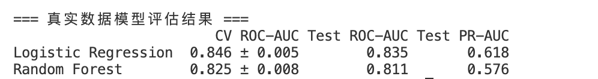

# cc-first-learning-project
a place to record my learning
# Hello GitHub! 这是我的第一个项目。
# 客户流失预测模型 (Customer Churn Prediction)

## 📌 项目背景
基于真实的电信客户公开数据集（Kaggle Telco Customer Churn），构建机器学习二分类模型，预测客户流失概率，辅助业务部门制定精准的营销挽留策略，降低运营成本。

## 🛠️ 技术栈
- **语言**：Python
- **数据处理**：Pandas, Numpy
- **机器学习**：Scikit-learn (Logistic Regression, Random Forest)
- **评估指标**：5折交叉验证 (CV), ROC-AUC, PR-AUC

## ⚙️ 核心步骤
1. **数据清洗**：处理 `TotalCharges` 空值与类型转换；将目标变量 `Churn` 映射为 0/1。
2. **特征工程**：对数值型特征进行标准化（StandardScaler），对类别特征进行独热编码（OneHotEncoder）。
3. **模型构建**：使用 `class_weight='balanced'` 解决样本不平衡问题，对比逻辑回归（基线）与随机森林的表现。

## 📊 评估结果

**结论**：逻辑回归模型在测试集上达到 **ROC-AUC 0.835**，优于随机森林（0.811）。证明在当前特征维度下，数据与目标变量呈线性关系。逻辑回归不仅表现更稳定，且具备高可解释性，便于业务团队定位流失原因。
